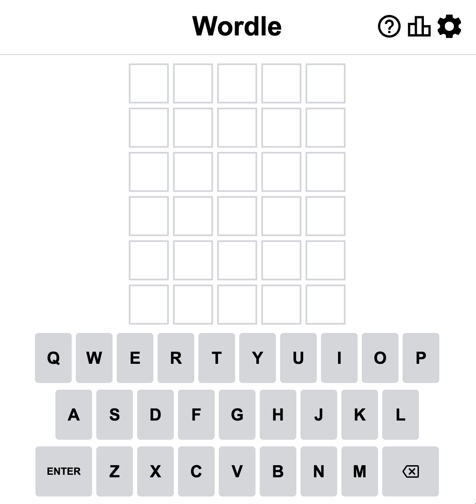

# Wordle Clone

A recreation of the popular word-guessing game [Wordle](https://www.nytimes.com/games/wordle/index.html), built with vanilla HTML, CSS, and JavaScript. For educational purposes only.

## How To Play

- Guess the word in 6 tries.
- Each guess must be a valid 5-letter word.
- After each guess, the color of the tiles will change to show how close your guess was to the word:
  - **Green** — the letter is in the word and in the correct spot.
  - **Yellow** — the letter is in the word but in the wrong spot.
  - **Gray** — the letter is not in the word.

## Features

- On-screen keyboard and physical keyboard support
- Hard Mode — revealed hints must be used in subsequent guesses
- Dark Theme
- High Contrast Mode
- Game statistics and guess distribution
- Share results

## Getting Started

Open `index.html` in a browser to play.
